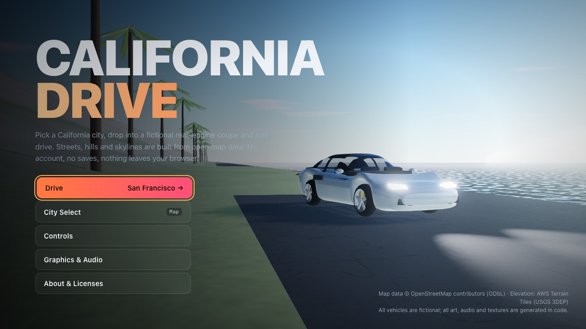
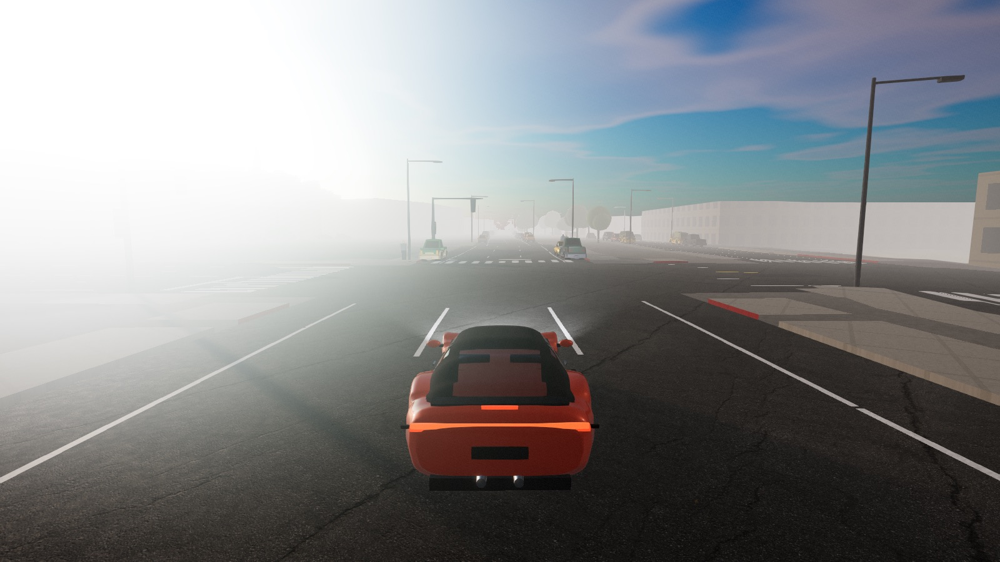
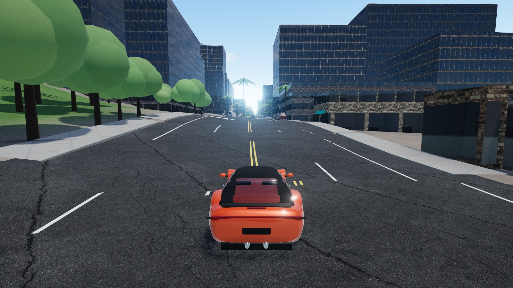
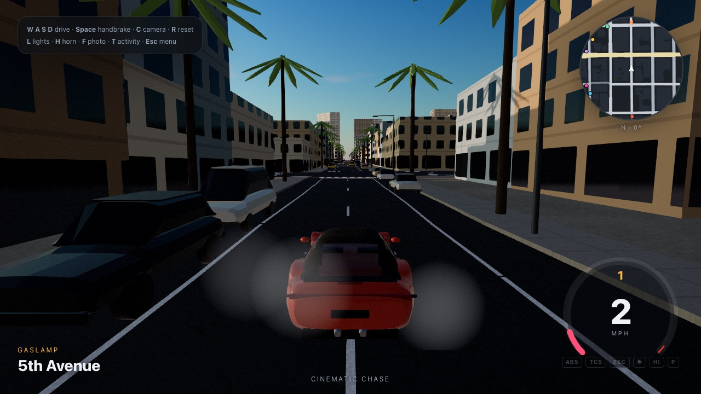
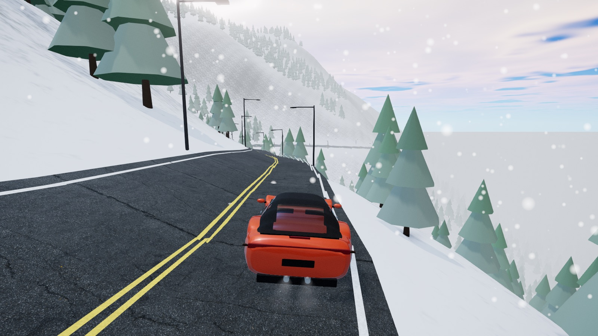
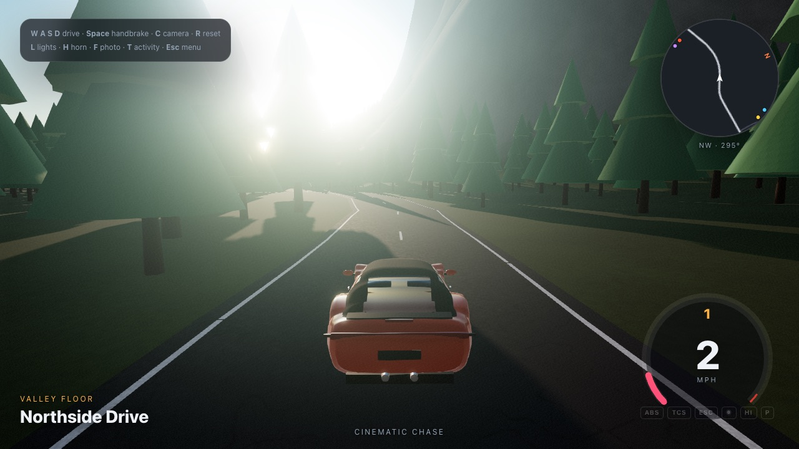
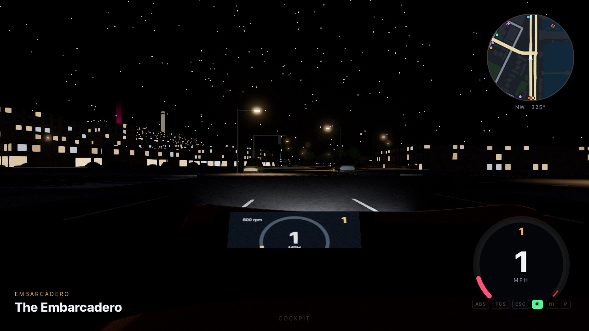
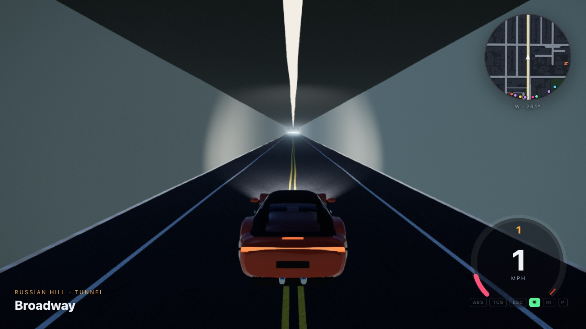

# California Drive

**▶ Play: https://roszhan2684.github.io/california-drive/** (desktop browser with WebGL2; keyboard or gamepad)

An accountless, browser-based open-world driving game set in California. Pick a city on a 3D relief map of the state, choose your car and paint in the garage, and drive streets built from open map data, with cinematic cameras, lighting, weather, traffic, pedestrians and fully synthesized sound.

- **No account, no backend, no analytics.** Settings and session bests live in `sessionStorage` and are gone when you close the tab. A **Reset Session** button wipes them immediately.
- **Free/open everything.** Code dependencies are MIT/Apache-2.0. Map data is © OpenStreetMap contributors (ODbL). Every sound is synthesized in code. Facade/asphalt textures and the sky HDRI are **CC0** from Poly Haven. The traffic fleet, crash debris, input glyphs and reticles are **CC0** from Kenney. Fonts (Bebas Neue, Rajdhani, Share Tech Mono, Inter, Barlow Condensed) are **SIL OFL** from Google Fonts and self-hosted. See [ASSET_LICENSES.md](ASSET_LICENSES.md) and [THIRD_PARTY_NOTICES.md](THIRD_PARTY_NOTICES.md).
- **Two cars.** The default is a procedural **BMW M3 Competition (G80)** approximation built from public specs: S58 twin-turbo inline-six, 503 hp, 650 Nm, 8-speed, RWD, 290 km/h limited. It's included for **personal, non-commercial use**. BMW, M3 and the roundel are BMW AG trademarks, and the project isn't affiliated with BMW. Badges can be toggled off. The fictional, brand-free *Vireo S6* coupe is the alternative for any public release (see [ASSET_LICENSES.md](ASSET_LICENSES.md)).

| | |
|---|---|
|  |  |
|  |  |
|  |  |
|  |  |

<sub>Screenshots are from headless Chrome with software rendering (SwiftShader). On a real GPU, shadows, anti-aliasing and frame rate are better.</sub>

## Regions

| Region | District | Identity |
|---|---|---|
| San Francisco | Embarcadero · North Beach · Russian Hill | Steep grades, Broadway & Stockton tunnels, "Karl the Fog" marine layer |
| Los Angeles | Downtown · Bunker Hill · Historic Core | Wide boulevards, freeway ramps, palms, neon dusk |
| San Diego | Gaslamp · Marina · Little Italy | Palms, harbor, golden hour |
| San Jose | Downtown · SoFA | Broad arterials, clean night light |
| Oakland | Downtown · Lake Merritt | Urban/industrial contrast |
| Sacramento | Capitol · Midtown | Flat tree-lined grid, capitol dome |
| Santa Monica | Coast Highway · Ocean Ave | Pacific sunsets, pier Ferris wheel |
| Lake Tahoe | Emerald Bay · Highway 89 | Alpine switchbacks; snow preset |
| Yosemite Valley | Northside & Southside Drives | Granite walls, forest roads |
| Proving Ground | Closed test track | Ramp, slalom cones, skid pad |

Each region is a bounded, road-accurate district built from OpenStreetMap plus an open DEM. It is not a 1:1 digital twin.

## Controls

| Action | Keyboard | Gamepad (standard) |
|---|---|---|
| Throttle / Brake & reverse | W / S (or ↑ / ↓) | RT / LT |
| Steer | A / D (or ← / →) | Left stick |
| Handbrake / drift | Space | A |
| Gear up / down (manual mode) | E / Q | RB / LB |
| Next / previous camera | C / X | Y |
| Look back | B (hold) | X |
| Reset vehicle | R | B |
| Headlights / high beam | L / K | D-pad up |
| Indicators / hazards | Z / V / G | D-pad left / right |
| Horn | H | L3 |
| Wipers | J | D-pad down |
| Engine start/stop · Parking brake | I · P | — |
| Start / cancel activity | T | R3 |
| Photo mode | F | Back |
| Radio | M | — |
| Pause menu | Esc | Start |
| Performance overlay · Tuning panel | F3 · F4 | — |

All keys can be remapped in **Pause → Controls**. Drag with the mouse (or use the right stick) to look around in interior views and to orbit in photo mode.

## Features

- **Driving model:** custom raycast vehicle on Rapier. Spring/damper suspension with anti-roll bars, combined-slip tyres (normalized magic formula + friction circle), torque curve, 7-speed gearbox (auto/manual), LSD, brake bias, handbrake, ABS / TCS (torque limit + brake intervention) / ESC / steering assist, aero drag and downforce, per-surface grip, wet/snow grip, fixed 120 Hz step.
- **Cameras:** cinematic chase, close chase, hood, cockpit (live gauges, steering wheel, wipers), dashboard, bumper, wheel, side tracking, and orbit/photo. Spring follow, look-ahead, velocity FOV, subtle roll, collision avoidance, smooth blends, reduced-motion mode.
- **World:** streamed 320 m chunks generated in a Web Worker. Terrain mesh and collider, roads with intersections, lane markings, crosswalks, stop lines, curbs and sidewalks, extruded buildings with a procedural facade/window shader, bridges with decks and railings, tunnels with cut terrain, portals and lights, piers, parks, streetlights with night light pools, signals, stop signs, parked cars, trees and palms, and hand-authored landmark overrides.
- **Traffic:** lane following on the OSM road graph, turn connectors, coordinated signal clusters, stop/yield reservations, IDM car-following with emergency braking around the player, spawn/despawn bubble, deadlock recovery, and kinematic collision bodies.
- **Atmosphere:** dynamic sun/sky with clouds, PMREM reflections, time-of-day presets with smooth transitions, clear/overcast/fog/rain/snow weather, wet roads with puddles, height fog plus the rolling **Karl the Fog** marine layer, tunnel exposure adaptation, bloom, color grade, speed blur and windshield rain.
- **VFX:** skid marks, tyre smoke, dust, wet spray, exhaust vapour, impact sparks, brake-disc glow and camera shake.
- **Audio (all synthesized):** layered flat-six engine with load and overrun crackle, shifts, tyre squeal, gravel, wind, road roar, rain, horn, indicator ticks, impacts, Doppler traffic, city/coast/forest ambience, tunnel reverb, interior muffling and a generative radio.
- **Activities (all optional):** scenic routes, time trials with in-memory **ghost car**, drift zones, speed traps, parking challenge, slalom, photo spots and landmark discovery.
- **Signature extras:** street-name callouts from OSM names, district entry toasts, and a **postcard photo mode** with four templates (Greetings from…, instant print, travel poster, clean frame) that downloads a PNG locally.
- **Realism pass:**
  - *City look:* textured facades (brick, stucco, concrete, plank siding) with interior-mapped windows, SF Victorian bay windows and cornices, neon signs, manholes, patches and red curbs. Ambient occlusion is baked into facades, sidewalks and terrain, with blob contact shadows under every car and tree.
  - *Night and rain:* real point lights at the nearest street lamps, volumetric lamp and headlight beams, wet-road light streaks, rain splashes, birds, and exhaust flames on overrun crackles.
  - *Traffic and pedestrians:* traffic shows turn signals, spinning steered wheels and contact shadows. Code-animated pedestrians walk the sidewalks, round block corners, cross with the lights and step out of your way.
  - *Car detail:* metallic-flake paint, drilled brake discs, sidewall lettering and speed-dependent wheel blur.
  - *Lens:* chromatic aberration at speed, exhaust heat haze, sun lens dirt (ray-tested against buildings and terrain), and photo-mode depth of field, focal-length presets and letterbox.
- **UI:**
  - *HUD:* M-style shift-light LEDs, rolling-digit speedometer, turbo boost gauge and a G-meter.
  - *Garage:* turntable showroom with paint picker and a spec radar. The specs are measured on the sim.
  - *City select:* 3D California relief built from open elevation data, with preview frames rendered by the game itself.
- **More audio:** turbo whistle and blow-off, drivetrain gear whine, door-seal wind whistle in the cockpit, and a cabin low-end boom vs brighter exhaust rasp outside.
- **Free-asset pass:**
  - *Traffic fleet (Kenney Car Kit, CC0):* taxis, police interceptors, ambulances, fire engines, box trucks, garbage trucks, pickups, panel vans, sport coupes, hot hatches and luxury SUVs join the procedural cars. They are stretched to real-world sizes and use real lamps. Spawns are weighted per region, so there are more taxis downtown and no fire engines on Highway 89. Civilian models also park at the kerb.
  - *Emergency vehicles:* about a quarter of police cars and half of the ambulances and fire engines are responding. They run alternating strobe lightbars, show flashing red and blue on the radar, and sound a synthesized siren (police wail, ambulance hi-lo, fire slow wail) with Doppler.
  - *Crash debris:* hard hits throw bolts, nuts, panels, bumpers, spoilers and even tyres. The panels take your paint colour. Pieces bounce and settle on the road, then shrink away.
  - *Santa Monica pier Ferris wheel:* it turns slowly with upright gondolas, and its LED rim runs a rainbow chase after dark.
  - *Cinematic HUD:* the HUD boots up with a scan line, a system log, an iris-open radar, a needle sweep and a bulb check. The minimap is now a sweeping radar with phosphor-fading blips. A reticle locks onto the nearest activity or checkpoint, rides the screen edge when the target is off-screen, and shows its distance. Toasts, panels, the pause sheet and the garage animate with Godot-style tweens (`TRANS_BACK`/`EASE_OUT` overshoot, elastic drops, springs).
  - *Typography:* Bebas Neue for titles, Rajdhani for instruments, Share Tech Mono for telemetry and Inter for body text.
  - *Input glyphs:* control hints and "Press T" prompts use Kenney keyboard glyphs. They switch to gamepad glyphs when you pick up a controller, and they follow your key remaps.

## Develop

```bash
npm install
npm run dev              # local dev server
npm run typecheck
npm test                 # Vitest: physics, world validation, traffic soak, activities, session/privacy, input
npm run build            # static site in dist/
npm run test:e2e         # Playwright: boot → select → drive → cameras → pause → reset session + network privacy audit
CD_VISUAL=1 npx playwright test visual   # optional screenshot gallery → qa-shots/visual
npm run check:licenses   # no-paid-dependency guardrail
npm run import:city -- sf   # re-import a district from OSM + DEM (one-time, cached in data/raw)
node --experimental-strip-types tools/fetch-assets.ts     # re-download the CC0 textures/HDRI, Kenney packs and OFL fonts into public/media
CD_UPGRADES=1 npx playwright test upgrades   # QA captures: HUD boot, fleet, debris, lock, Ferris wheel → qa-shots/upgrades
node --experimental-strip-types tools/build-ca-relief.ts  # rebuild the city-select relief from terrain tiles
CD_PREVIEWS=1 npx playwright test previews   # re-render public/previews/<city>.jpg
CD_UISHOTS=1 npx playwright test uishots     # UI review captures → qa-shots/ui
CD_PLACES=1 CD_PLACE_LIST="name:sf:day:37.8015,-122.4185:0" npx playwright test places   # shots at exact places (';'-separated list)
```

Dev/QA URL parameters: `?city=sf&time=golden&weather=fog&skip=1` loads straight into a district. `&at=lat,lon` teleports to a spot (tunnels allowed), `&ao=0|1` toggles baked AO and `&hdri=0` disables the photo sky.

## Deploy

Every push to `main` deploys to GitHub Pages via `.github/workflows/pages.yml`. That build sets `VITE_PUBLIC_BUILD=1`, so it ships only the fictional Vireo S6 (no branded vehicles). Local builds keep the M3.


`npm run build` produces a static `dist/` folder for any static host (Cloudflare Pages, Netlify, Vercel, GitHub Pages). `public/_headers` and `vercel.json` set a strict CSP and cache headers. Download sizes: title ≈ 280 KB gzip; world + physics ≈ 1.7 MB gzip, loaded on demand; each district 0.5–2.4 MB JSON (≈ 0.25–0.85 MB gzip); CC0 textures + HDRI ≈ 3.4 MB and fonts ≈ 0.2 MB (cached after first visit; the game renders with procedural fallbacks until they arrive); relief 204 KB; city previews ≈ 0.1 MB each.

## Documentation

- [ADR-001 Engine & physics](docs/01-ADR-engine-physics.md)
- [Architecture & ownership map](docs/02-architecture-and-ownership.md)
- [Phase 0/1 task graph](docs/03-phase0-phase1-task-graph.md)
- [Performance budgets](docs/04-performance-budgets.md)
- [Asset intake template](docs/05-asset-intake-template.md)
- [Test strategy](docs/06-test-strategy.md)
- [Driving vertical slice acceptance criteria](docs/07-acceptance-criteria.md)
- [QA checklists](docs/08-qa-checklists.md)
- [Risk register](docs/09-risk-register.md)
- [Workstreams & phase status](docs/10-workstreams-and-status.md)

## Attribution

Map data © OpenStreetMap contributors (ODbL). Elevation: AWS Terrain Tiles (USGS 3DEP and other open sources). Code: MIT.
